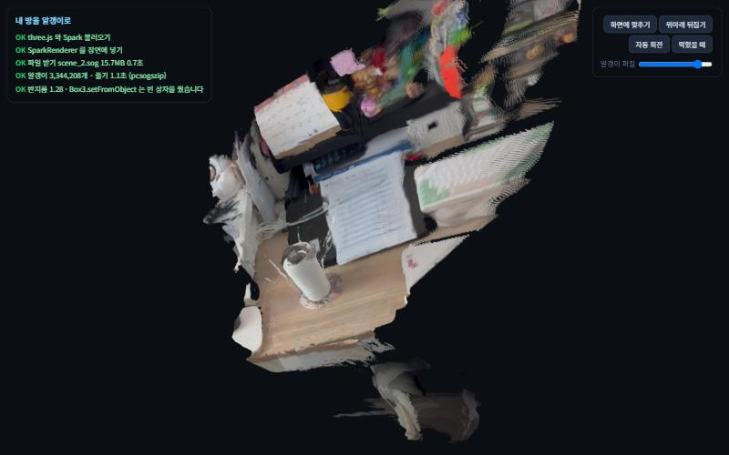
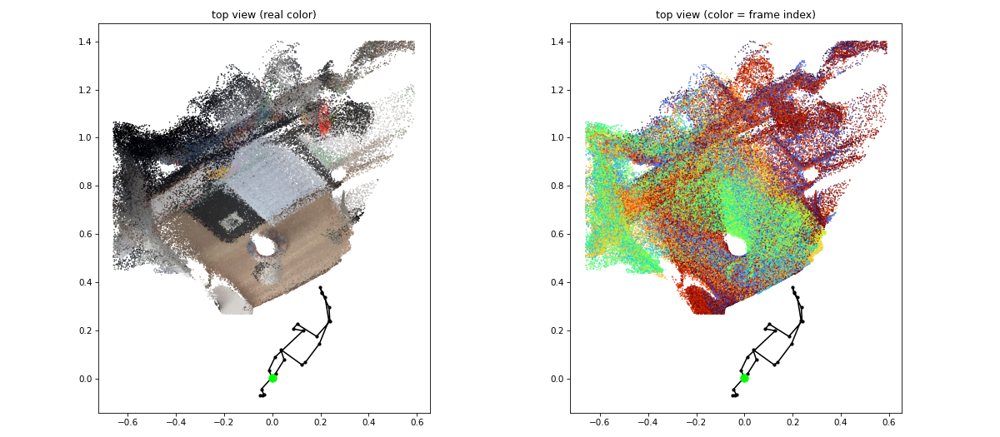
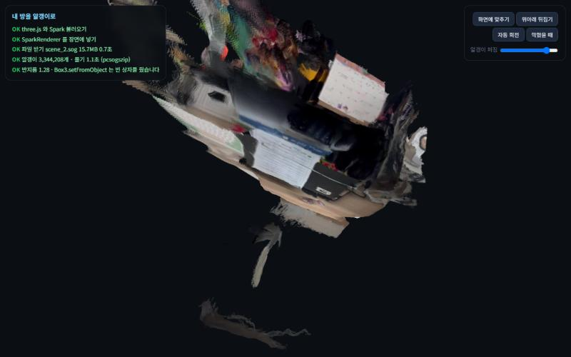
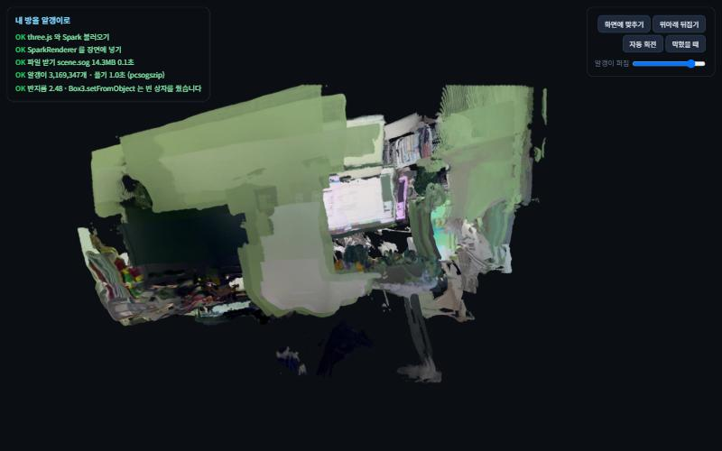

# 우리 집 책상을 알갱이로

폰으로 찍은 영상 하나로 책상 주변을 3D 가우시안 스플랫으로 만들고, 웹에서 돌려 볼 수 있게 올렸습니다.

**보기** https://benjy89a.github.io/my-open-space/

## 1. 어떤 공간을 골랐고 왜 공개해도 되는지

- 공간: 우리 집 책상 위와 주변 (컵, 키보드, 모니터 받침, 책상 위 종이, 뒤쪽 선반)
- 공개해도 되는 이유: 우리 집이고 촬영과 공개 모두 본인이 결정할 수 있다. 얼굴, 문패, 차량 번호는 화면에 없다.
  책상 위 종이 문서는 뷰어에서 최대로 확대해도 글자를 읽을 수 없음을 확인했다.

## 2. 촬영

| 항목 | 값 |
|---|---|
| 촬영 범위 | 책상 앞에서 책상 위와 뒤쪽 선반까지 |
| 걸은 경로 | 책상 앞에서 좌우로 지그재그로 오가며 몸을 옆으로 옮김 (제자리 회전 아님) |
| 영상 길이 / 해상도 | 17.8초 / 1280×720 가로 (카카오톡으로 옮긴 파일, 2.3MB) |
| 추출한 프레임 | 24장 (영상 길이에 맞춰 고른 간격, 초당 약 1.35장) |

## 3. 복원 결과

- 모델: `facebook/map-anything-apache`, 코랩 T4, `fp16`
- 복원 12.1초, 최대 GPU 메모리 6.74GB (모델 준비 49초 별도)
- 점 3,438,977개 → 각 축 0.5~99.5 백분위 밖의 튄 점을 버리고 **3,344,208개**
- **카메라 퍼짐 비 0.229** (카메라 퍼짐 0.588 ÷ 장면 대각선 2.563). 기준 0.1보다 커서 걸으며 찍은 것으로 판단
- 알갱이 반지름 K = 1.4, 불투명도 0.9, 구면 조화 0차만 사용 → 알갱이당 68바이트

**실제 촬영 경로와 비교.** 아래 그림의 검은 선이 추정한 카메라 위치(초록 점이 첫 장)입니다.
실제로 책상 앞에서 좌우로 왔다 갔다 하며 찍었는데, 추정 경로도 책상 앞쪽에서 지그재그로 나와 실제와 맞습니다.
오른쪽 그림은 점을 '몇 번째 사진에서 왔는지'로 칠한 것입니다. 책상 면에서 여러 사진의 색이 한 면 위에 고르게 섞여 있어
사진끼리 위치가 잘 맞았다고 볼 수 있습니다.

## 4. 형식 비교 (이 장면의 PLY 로 직접 측정)

변환: `npx -y @playcanvas/splat-transform@3.10.3 -w` (Windows PC). 뷰어: three.js 0.185.1 + Spark 2.4.0.

| 형식 | 파일 크기 (바이트) | 변환 시간 | 알갱이 개수 | 알갱이당 바이트 |
|---|---:|---:|---:|---:|
| `.ply` (원본) | 227,406,561 | – | 3,344,208 | 68.00 |
| `.compressed.ply` | 54,448,598 | 2.9초 | 3,344,208 | 16.28 |
| `.sog` | 16,475,921 | 4.5초 | 3,344,208 | 4.93 |
| `.spz` | 18,540,102 | 5.9초 | 3,344,208 | 5.54 |

- 네 형식의 알갱이 개수가 같다. 압축은 내려받을 양만 줄이고 그릴 양은 그대로다.
- 카메라를 고정하고 파일만 바꿔(페이지에 끌어다 놓기) 같은 시점에서 비교했다. 책상 위 종이와 모서리에서 차이를 눈으로 구분하지 못했다.
- `.ply` 는 GitHub 파일 한도 100MiB 를 넘는다. 가장 작고 화질 차이가 보이지 않은 **`.sog`** 를 올렸다.
- 함정: splat-transform 3.10.3 의 `.spz` 는 SPZ v4 라서 Spark 2.1.0 은 `Invalid gzip header` 로 못 읽었다. Spark 2.4.0 으로 올려 해결했다.

## 5. 첫 화면까지 걸린 시간

| 기기 | 통신 | 첫 화면까지 |
|---|---|---|
| 내 PC (로컬 서버) | – | 파일 받기 0.7초, 알갱이로 풀기 1.1초 |
| ✏️ 내 폰 (기종) | ✏️ Wi-Fi / LTE | ✏️ 초 |
| ✏️ 다른 사람 폰 (기종) | ✏️ Wi-Fi / LTE | ✏️ 초 |

## 6. 잘 보이는 방향과 무너지는 방향

**잘 보이는 방향: 책상 정면, 약간 위에서.** 촬영할 때 걸은 쪽이라 컵, 키보드, 종이, 달력이 또렷하다.

**무너지는 방향: 반대편(책상 뒤, 벽 쪽)에서 볼 때.**

- 검게 빈 곳: 영상에서 렌즈가 한 번도 지나가지 않은 면(물건 뒷면, 책상 아래)이다. 모델은 사진에 없는 면을 지어내지 않는다.
- 뒤쪽 선반과 오른쪽 위 벽이 성기고 늘어져 보인다: 원본 영상에서 촬영 끝부분 몇 장에만 비스듬히 찍혔다. 점 그림에서도 그 부분은 마지막 사진들의 색만 있다.
- 케이블처럼 가는 물체가 뭉개진다: 모델이 사진을 518×294로 줄여서 보기 때문이다. 카톡을 거치며 영상이 압축된 것도 영향이 있다.

### 첫 시도에서 배운 것 (영상 1)

처음에는 방 전체를 20.1초 동안 넓게 찍었다(퍼짐 비 0.314, 점 317만 개). 결과에서 물건 하나가 5~8겹으로 겹쳐 보였다.

이 방식은 사진마다 깊이를 따로 추정해 점을 그대로 합치기 때문에, 사진 사이 위치가 조금만 어긋나도 같은 물건이 여러 벌 생긴다.
범위를 책상 하나로 좁히고 가까이서 지그재그로 다시 찍었더니 사진끼리 잘 맞아 겹침이 크게 줄었다.
다음에는 카톡을 거치지 않은 폰 원본 영상을 쓰고, 3DGS 학습을 추가해 겹친 알갱이를 하나로 모아 볼 생각이다.

## 파일

| 파일 | 내용 |
|---|---|
| `index.html` | 뷰어 (three.js + Spark 2.4.0). 파일을 화면에 끌어다 놓으면 같은 시점에서 바꿔 볼 수 있음 |
| `scene.sog` | 알갱이 3,344,208개, 16.5MB |
| `shots/` | 뷰어 화면, 반대편 화면, 카메라 경로, 첫 시도 화면 |
| `.nojekyll` | GitHub 이 파일 이름을 손대지 않게 하는 표시 |
